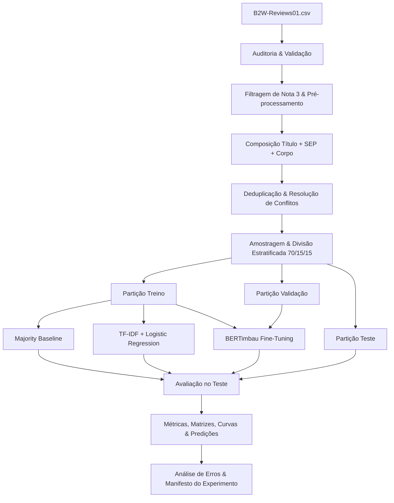

# Arquitetura de Software e Design do Sistema

Este documento descreve as decisões de arquitetura, organização modular, fluxo de dados e princípios de engenharia aplicados no projeto `sentiment_transformer`.

---

## 1. Princípios de Engenharia de Software

O projeto segue princípios rigorosos de modularidade, separação de responsabilidades e reprodutibilidade científica:

1. **Separação entre Domínio, I/O e Apresentação**: A lógica de dados, modelos e avaliação reside em módulos reutilizáveis e testáveis em `src/sentiment_transformer/`. Interfaces CLI e scripts são camadas finas (wrappers) que não contêm regras de negócio.
2. **Configuração Externa Imutável**: Nenhum hiperparâmetro fica disperso no código. Todos os parâmetros experimentais são validados a partir de arquivos YAML (`configs/`). Ao iniciar cada execução, a configuração resolvida é salva em `config_resolved.yaml`.
3. **Imutabilidade e Isolamento de Execuções**: Cada execução de experimento cria um diretório imutável em `artifacts/runs/<run_id>/`, garantindo rastreabilidade sem sobrescrever execuções anteriores.
4. **Compatibilidade Multiplataforma**: Uso exclusivo de `pathlib.Path` para manipulação de caminhos de arquivos, garantindo suporte nativo e consistente no Windows e PowerShell.
5. **Rastreabilidade e Linhagem Criptográfica**: Todos os datasets brutos e partições processadas são auditados com hashes SHA-256 e registrados em manifestos JSON imutáveis.

---

## 2. Visão Geral dos Módulos

```text
src/sentiment_transformer/
├── config.py              # Esquema tipado, carregamento e validação de configurações YAML
├── constants.py           # Constantes centralizadas (rótulos, nomes de colunas, justificativas)
├── exceptions.py          # Hierarquia de exceções específicas do domínio
├── paths.py               # Resolução de caminhos com pathlib.Path
├── logging_config.py      # Configuração de logging estruturado
├── reproducibility.py     # Controle de sementes e hashes criptográficos
├── data/                  # Subsistema de dados
│   ├── download.py        # Download com streaming, validação de integridade e fallback manual
│   ├── validation.py      # Detecção de encoding, delimitador e mapeamento de colunas
│   ├── loader.py          # Carregamento e padronização de DataFrames
│   ├── audit.py           # Auditoria completa, distribuições e valores ausentes
│   ├── preprocessing.py   # Rotulagem binária, exclusão da nota 3 e composição título+corpo
│   ├── deduplication.py   # Normalização de texto, remoção de duplicatas e resolução de conflitos
│   └── splitting.py       # Amostragem balanceada e divisão estratificada 70/15/15
├── baselines/             # Modelos de referência
│   ├── majority.py        # Baseline de classe majoritária (DummyClassifier)
│   └── tfidf_logistic.py  # Pipeline TF-IDF com Regressão Logística
├── modeling/              # Subsistema Transformer
│   ├── device.py          # Detecção de hardware (CUDA GPU e fallback automático para CPU)
│   ├── tokenizer.py       # Carregamento do tokenizer BERTimbau e identificação de sep_token
│   ├── dataset.py         # PyTorch Dataset para tokenização de avaliações
│   ├── trainer.py         # Fine-tuning, validação por época, early stopping e salvamento de checkpoint
│   └── inference.py       # Inferência em lote em DataLoader PyTorch
├── evaluation/            # Avaliação científica e análise de erros
│   ├── metrics.py         # Cálculo de acurácia, F1 macro, F1 por classe e matriz de confusão
│   ├── plots.py           # Gráficos com rótulos e títulos em português
│   ├── predictions.py     # Estruturação e salvamento de predições com probabilidades
│   └── error_analysis.py  # Heurística de negações e seleção sistemática de casos de erro
├── evidence/              # Geração de evidências para publicação
│   ├── fingerprints.py    # Hashes SHA-256 de dados brutos e processados
│   ├── environment.py     # Auditoria de ambiente de execução, hardware e versões de pacotes
│   ├── manifest.py        # Manifesto consolidado da execução (run_manifest.json)
│   └── report.py          # Relatórios comparativos em Markdown e CSV
└── pipeline/              # Orquestração do pipeline
    ├── phases.py          # Funções de execução individual por fase (data, baselines, transformer, etc.)
    └── orchestrator.py    # Orquestrador ponta a ponta que gerencia o ciclo de vida do run
```

---

## 3. Fluxo de Dados e Pipeline



---

## 4. Três Níveis de Execução

O sistema suporta três modos de interação equivalentes:

1. **Nível 1 (Scripts wrappers)**: Execução granular de comandos isolados em `scripts/` (ex: `scripts/download_data.py`, `scripts/train_transformer.py`).
2. **Nível 2 (Fases do pacote)**: Execução por fase via CLI do pacote (`python -m sentiment_transformer.cli phase <nome>`).
3. **Nível 3 (Pipeline completo)**: Execução ponta a ponta com criação de run isolado (`python -m sentiment_transformer.cli run --config configs/default.yaml`).
